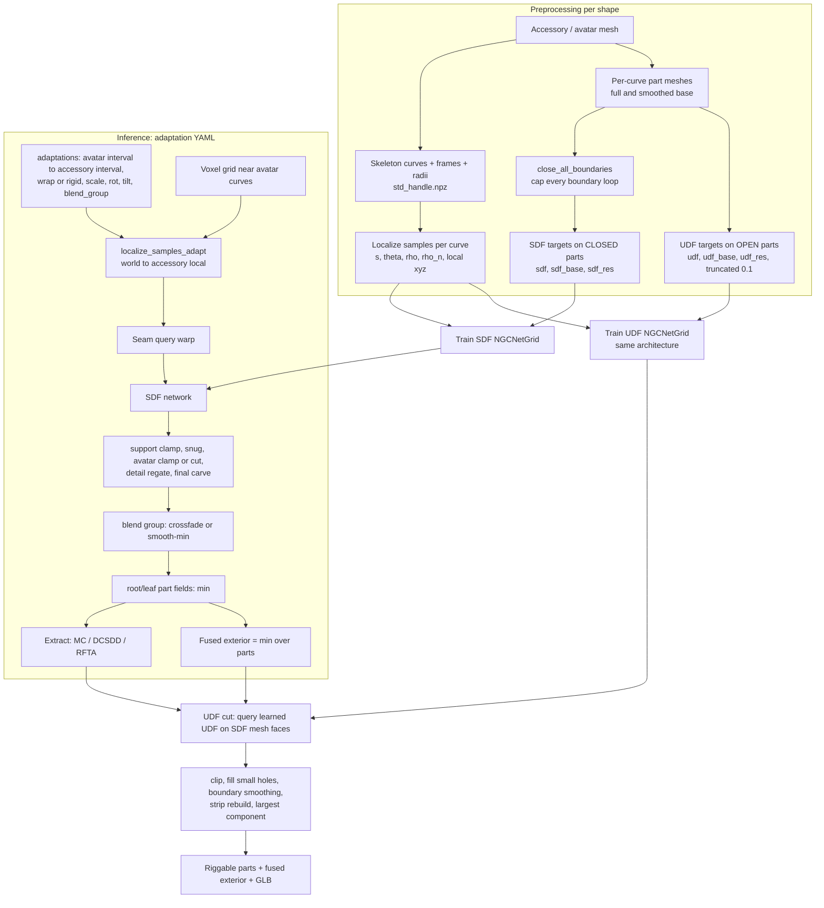

# Oktopus, explained from the code

*A walkthrough of what the repository actually does: the pipeline step by step, the mathematics behind each step, how the unsigned distance field (UDF) is used together with the signed distance field (SDF), how cleanup and seam optimization work, and what to read.*

Scope: this is written from the code on branch `udf-sdf-714b770` (the most recent patch notes are `README_UDF_0107_SDF_ONLY_DIRECT.md`, `README_0093_GENERIC_WRAP.md`, and `README_0087_FUSED_SDF.md`). It covers the live pipeline: `src/ngc`, `src/network`, `src/training`, `src/data`, `SDF/preprocess`, `UDF/preprocess`, and `src/app`. The `_archive/`, most of `tests/`, and the old per-patch READMEs were not read line by line.

Links are relative to this folder, so they open in your editor.

---

## Contents

1. [The problem Oktopus solves](#1-the-problem-oktopus-solves)
2. [The whole pipeline in one picture](#2-the-whole-pipeline-in-one-picture)
3. [Generalized-cylinder handles: curves, frames, local coordinates](#3-generalized-cylinder-handles)
4. [The neural field: architecture](#4-the-neural-field-architecture)
5. [Training data: SDF targets on closed parts, UDF targets on open parts](#5-training-data)
6. [Training: phases and losses](#6-training-phases-and-losses)
7. [Adaptation: mapping a world point into accessory space](#7-adaptation-the-core-mapping)
8. [SDF composition: avatar-aware corrections, groups, parts, fused exterior](#8-sdf-composition)
9. [Seam optimization](#9-seam-optimization)
10. [How the UDF is used with the SDF](#10-how-the-udf-is-used-with-the-sdf)
11. [Cleaning: what happens after a cut](#11-cleaning)
12. [Surface extraction](#12-surface-extraction)
13. [Engineering layer: patch numbers, streaming, flags](#13-engineering-layer)
14. [Observations worth knowing before writing the paper](#14-observations-worth-knowing-before-writing-the-paper)
15. [Reading list](#15-reading-list)
16. [Notation and file index](#16-notation-and-file-index)

---

## 1. The problem Oktopus solves

The baseline, **Neural Generalized Cylinder (NGC)**, represents a shape as a set of generalized cylinders. Each cylinder has a skeletal curve, a moving frame, and a cross-section radius. It learns one neural SDF per cylinder in that cylinder's **local** coordinates. Editing the curve (bending, stretching, scaling the radius) edits the shape, because the network is queried in coordinates that move with the curve.

Oktopus uses that idea for **accessory transfer**. An accessory such as a puffer jacket, a boot, a dress, or a cone hat has its own NGC handles. An avatar such as the octopus `oktopus_9_v1`, an armadillo, or a T-Rex also has NGC handles. Oktopus fits the accessory onto the avatar without retraining. It maps world points near the avatar curve into the accessory's local coordinates and evaluates the accessory's network there.

The main loop is: for each world point $x$ near an avatar curve,

$$x \;\xrightarrow{\text{localize on avatar}}\; (s_A, w, u, v) \;\xrightarrow{\text{map}}\; (s_C, w', u', v') \;\xrightarrow{\text{network}}\; \varphi_C .$$

The code and patch notes add four things to that loop:

1. **Fitting operators.** These make an accessory hug or clear the body: wrap-radius mapping, snug field, avatar clearance and avatar Boolean.
2. **Multi-piece assembly.** One accessory can be split across several avatar curves. The puffer uses 15 adaptations covering the body and 8 tentacles. These pieces are blended in *groups*, and their **seams** are optimized.
3. **Riggable output.** Output is one mesh per avatar part ("root/leaf parts": body plus `tentacle_t1..t8`) plus a true Boolean-fused exterior.
4. **Openings.** Garments have necks, sleeves, and bottoms. A learned SDF needs a closed volume, so the training meshes are capped, and those caps reappear as false surfaces after transfer. A second network, an **unsigned** distance field (UDF) trained on the *open* mesh, is used to detect and cut those caps.

---

## 2. The whole pipeline in one picture



Entry points:

| Stage | Entry script | Core code |
|---|---|---|
| SDF data | `SDF/preprocess/process_data_3dvec_closed_v2.py` | closure: `sdf_closure_utils_v2.py`, `close_all_boundaries.py` |
| UDF data | `UDF/preprocess/process_data_3dvec_udf_keep_cylinder.py` | `udf_open_mesh_utils.py` |
| Training | `train_net_3dvec.py` | `src/training/train_3dvec.py`, `loss_3dvec.py`, `src/network/model_withgrid.py` |
| SDF inference | `test_dc.py` / `test_dc_oct22_editable.sh` | `src/app/agent_3dvec_sdf.py` (+ `_dc` for DCSDD) |
| UDF cut | `test_udf_sdf_cut_stitch.py`, `tools/udf_0100_run_direct.py` | `src/app/agent_3dvec_udf_cut.py`, `udf_direct_surface_0100.py` |

---

## 3. Generalized-cylinder handles

### 3.1 What a curve stores

A shape is a `Handle` ([handle_3dvec.py:464](../src/ngc/handle_3dvec.py#L464)). It holds a list of `CurveHandle`s, and each wraps a `PWLACurve`, a piecewise-linear arc-length curve assembled from mixins in [`src/ngc/pwla_curve/`](../src/ngc/pwla_curve/). `set_curve` ([_core.py:61](../src/ngc/pwla_curve/_core.py#L61)) loads the following, per keypoint $k = 0..K-1$:

| Symbol | Code | Meaning |
|---|---|---|
| $p_k \in \mathbb R^3$ | `key_points` | skeleton keypoints |
| $s_k \in [0,1]$ | `key_ts` | normalized cumulative arc length ([_core.py:352](../src/ngc/pwla_curve/_core.py#L352)) |
| $F_k = [T_k; N_k; B_k]$ | `key_frame` | orthonormal frame, rows = tangent, normal, binormal |
| $r_k = (r_{y,k}, r_{z,k})$ | `key_train_radius` | elliptical cross-section radii used to **normalize** network inputs |
| $r^{cyl}_k$ | `key_cylinder_radius` | larger radii used only to **gate** which points a curve owns |
| $W(s,\theta)$ | `key_wrap_radius` (+ `wrap_s_bins`, `wrap_theta_bins`) | directional wrap envelope: outer radius of the surface around the curve per $(s,\theta)$ |
| — | `surface_points_owned/all/base` | surface samples that belong to this curve |

$$s_k = \frac{\sum_{j<k}\lVert p_{j+1}-p_j\rVert}{L},\qquad L = \sum_j \lVert p_{j+1}-p_j\rVert .$$

The cylinder radius is inflated at load time by type. For avatars, $r^{cyl} = 1.8\,r + 0.02$ ([handle_3dvec.py:482](../src/ngc/handle_3dvec.py#L482)). For accessories, it is $1.0\,r + 0.02$. This inflation does not change the training radius, so it does not change what the network sees. It only changes which grid points get evaluated.

### 3.2 Interpolation at any $s$

`interpolate` ([_interpolate.py:66](../src/ngc/pwla_curve/_interpolate.py#L66)) linearly interpolates points and radii in $s$. Frames are interpolated entry-wise and re-orthonormalized by Gram–Schmidt ([_frames.py:242](../src/ngc/pwla_curve/_frames.py#L242)):

$$\tilde F(s) = \operatorname{lerp}(F_k, F_{k+1}),\quad T = \tfrac{\tilde T}{\lVert\tilde T\rVert},\quad N = \tfrac{\tilde N - (\tilde N\cdot T)T}{\lVert\cdot\rVert},\quad B = T\times N .$$

### 3.3 Frames: parallel transport

When a curve is edited, `update_frame` ([_frames.py:155](../src/ngc/pwla_curve/_frames.py#L155)) rebuilds frames by **discrete parallel transport**, also called a rotation-minimizing frame. Tangents are averaged edge directions. Each normal is carried forward by the minimal rotation that takes $T_{k-1}$ to $T_k$, using Rodrigues' formula:

$$v = T_{k-1}\times T_k,\quad c = T_{k-1}\cdot T_k,\quad R_k = I + [v]_\times + \frac{[v]_\times^2}{1+c},\qquad B_k = R_k B_{k-1}.$$

This is what keeps the angular coordinate $\theta$ from twisting when a curve bends.

### 3.4 Projecting a point onto the curve

`curve_projection` ([_geometry.py:231](../src/ngc/pwla_curve/_geometry.py#L231)) builds a dense polyline: $N$ uniform samples plus the keypoints. It finds the nearest polyline vertex with a KD-tree, then refines onto an adjacent edge with the rules in `_assign_ts` ([_geometry.py:59](../src/ngc/pwla_curve/_geometry.py#L59)):

- **Interior vertex.** If exactly one adjacent edge contains the orthogonal foot point (an XOR rule), use the edge's interpolated $t$. Otherwise keep the vertex's $t$.
- **End vertex.** Accept the edge projection only if it falls inside the edge. Otherwise return $-1$, which marks the point as outside the curve's extent, unless `outside=True` clamps it to the end.

Two refinements exist for adapted queries. *Interval projection* (`projection_s0/s1`) projects only onto the avatar sub-interval being adapted, so a point near a crossing does not snap to the wrong branch. *Loop-aware K-candidates* keep, per point, the candidate arm with the smallest normalized radial distance ([_localize.py:112](../src/ngc/pwla_curve/_localize.py#L112)).

### 3.5 Local coordinates and the cylinder gate

Given $s = \pi(x)$ with $c(s)$, $F(s)$, and $r(s)$, `localize_samples` ([_localize.py:146](../src/ngc/pwla_curve/_localize.py#L146)) computes

$$\ell = F(s)\,\big(x - c(s)\big) = (w,u,v)$$

and keeps the point only if it lies inside the (inflated) elliptic cylinder:

$$\Big\lVert \big(w,\; u/r^{cyl}_y(s),\; v/r^{cyl}_z(s)\big)\Big\rVert \le \nu \qquad(\nu=\texttt{norm},\ \text{default } 1).$$

The network inputs are then ([_localize.py:340](../src/ngc/pwla_curve/_localize.py#L340)):

$$
\hat\ell = \Big(\underbrace{w/x_r + 2s-1}_{\text{longitudinal}},\; \underbrace{u/r_y}_{u_n},\; \underbrace{v/r_z}_{v_n}\Big),\quad
\rho=\sqrt{u^2+v^2},\quad \rho_n=\sqrt{u_n^2+v_n^2},\quad \theta=\operatorname{atan2}(v_n,u_n).
$$

The axial radius $x_r$ is always $1$ ([_radius.py:242](../src/ngc/pwla_curve/_radius.py#L242)). For an interior orthogonal projection $w \approx 0$; it is nonzero only beyond the curve ends.

A curve also defines an analytic **cylinder SDF** ([_geometry.py:573](../src/ngc/pwla_curve/_geometry.py#L573)) and a "global implicit" Euclidean distance to the elliptic tube ([_geometry.py:621](../src/ngc/pwla_curve/_geometry.py#L621)). These are used for masks and visualization, not as learned geometry.

### 3.6 The wrap field

The wrap field $W(s,\theta)$ is the **outer envelope** of the surface around the curve: a robust upper quantile of $\rho$ per $(s,\theta)$ bin. It is computed in preprocessing. `build_circular_envelope_wrap_from_points` ([_wrap.py:33](../src/ngc/pwla_curve/_wrap.py#L33)) shows the method: project points, take the $q=0.995$ quantile of $\rho$ per $s$-bin, fill empty bins by interpolation, smooth with a Gaussian, add clearance, and optionally flare. At query time `interpolate_wrap_radius` ([_interpolate.py:295](../src/ngc/pwla_curve/_interpolate.py#L295)) does bilinear lookup that is linear in $s$ and periodic-linear in $\theta$. The adaptation step uses the wrap field to say "the avatar is this fat here, and the accessory is that fat there".

---

## 4. The neural field: architecture

`NGCNetGrid` ([model_withgrid.py:477](../src/network/model_withgrid.py#L477)) is one network shared by all curves of all training shapes. Each curve is identified by a learned code. The **same architecture** is trained twice: once on SDF targets and once on UDF targets. The config files differ only in `file_name` and `field` (`config/config_udf_grid_*.yaml`).

### 4.1 Curve conditioning

For curve $c$ with code $z_c\in\mathbb R^{256}$ (an `nn.Embedding`) and sample coordinate $s$ ([model_withgrid.py:570](../src/network/model_withgrid.py#L570)):

$$h_c = \mathrm{MLP}\big([\,z_c,\ \gamma(s),\ \gamma(\log r_y),\ \gamma(\log r_z)\,]\big) + \tau_{\text{curve}},$$

where $\gamma$ is a sinusoidal positional encoding with 24 frequencies and $\tau$ is a learned two-entry "type" embedding: curve vs. sample. The radius enters through $\log r$, so the network knows how thick the cylinder is at this $s$.

### 4.2 Sample features: curve–angle and curve–radius planes

Instead of a 3D grid, the features live on 2D planes that are aligned with the cylinder parameterization ([triplane.py](../src/network/triplane.py)):

- **Curve–theta plane** $G_{s\theta}$: a multi-resolution stack of learnable feature images. Rows index $s$ and columns index $\theta$. Sampling is bilinear.
- **Curve–rho plane** $G_{s\rho}$, base1 only: rows index $s$, columns index $\rho_n\in[0,1]$.

The angle is also encoded with a periodic encoding $\gamma_\theta(\theta)=(\sin k\theta,\cos k\theta)_{k=1}^{24}$.

### 4.3 FiLM chain

Each branch is a stack of FiLM layers ([model_withgrid.py:72](../src/network/model_withgrid.py#L72)):

$$x \leftarrow \mathrm{SiLU}\big(\gamma(h_c)\odot (W x + b) + \beta(h_c)\big),$$

with residual connections after the first layer. $\gamma$ is initialized to $1$ and $\beta$ to $0$, so FiLM starts as the identity.

### 4.4 Three-branch residual field: base1, base2, detail

$$
\begin{aligned}
\varphi_{b1} &= D_1\big(\mathrm{FiLM}([\rho,\ G^{(1)}_{s\theta}(s,\theta),\ G^{(1)}_{s\rho}(s,\rho_n)];\, h_c)\big)\\
\varphi_{b2} &= D_2\big(\mathrm{FiLM}([\rho_n,\ G^{(2)}_{s\theta},\ \gamma_\theta(\theta),\ \operatorname{sg}(\varphi_{b1})];\, h_c)\big)\\
\varphi_{\text{base}} &= \varphi_{b1} + g(\varphi_{b1})\,\varphi_{b2}\\
\varphi_{d} &= D_3\big(\mathrm{FiLM}([\rho_n,\ G^{(3)}_{s\theta},\ \gamma_\theta(\theta),\ \operatorname{sg}(\varphi_{\text{base}})];\, h_c)\big)\\
\varphi &= \varphi_{\text{base}} + g(\varphi_{\text{base}})\,\varphi_d,
\qquad g(\phi) = \exp\!\big(-\phi^2/2\sigma^2\big),\ \sigma = 0.01
\end{aligned}
$$

Here $\operatorname{sg}$ is stop-gradient (`.detach()`). The Gaussian gate $g$ confines both residuals to a narrow band around the current zero set. The coarse field fixes topology and far-field values, and the residuals add detail only near the surface ([model_withgrid.py:317](../src/network/model_withgrid.py#L317), [:637](../src/network/model_withgrid.py#L637)). Base1 sees the **physical** $\rho$, while base2 and detail see the **normalized** $\rho_n$.

At inference, `_inference_full_vals` returns `dist`, `dist_base`, and `dist_detail` separately. The SDF agent depends on this: it applies body-fit corrections to the **base** only and then re-gates the detail (§8.2).

---

## 5. Training data

### 5.1 Two targets per sample: full and base

Every training curve has two part meshes:

- **full**: the real geometry.
- **base**: a smoothed version (see `SDF/preprocess/smooth_mesh.py`).

For every sample, preprocessing stores

$$\varphi^{\text{full}},\quad \varphi^{\text{base}},\quad \varphi^{\text{res}} = \varphi^{\text{full}}-\varphi^{\text{base}},$$

for SDF as `sdf, sdf_base, sdf_res` ([process_data_3dvec_closed_v2.py:918](../SDF/preprocess/process_data_3dvec_closed_v2.py#L918)) and for UDF as `udf, udf_base, udf_res`. The base branch learns $\varphi^{\text{base}}$ and the detail branch learns the residual. This is the data-side counterpart of §4.4.

### 5.2 SDF oracle on closed parts

A neural SDF needs an inside and an outside. Accessory parts are open: a sleeve part has two rims, and a jacket body has a neck, two armholes, and a bottom. So every part is **closed** first.

`close_all_boundaries` ([close_all_boundaries.py:908](../SDF/preprocess/close_all_boundaries.py#L908)) works as follows:

1. Find boundary edges, meaning edges used by one face, and order them into simple loops.
2. Project each loop onto a best-fit plane. It tries the Newell normal and then Fibonacci-sphere directions until the 2D polygon is simple.
3. Triangulate with constrained Delaunay. If that fails or conflicts with the source topology, it falls back to constrained ear clipping, and then to a center fan.
4. Fix winding and normals, and verify that no boundary edges remain.

`ClosedPartSDFOracle` ([sdf_closure_utils_v2.py:516](../SDF/preprocess/sdf_closure_utils_v2.py#L516)) refuses any mesh that is not watertight, winding-consistent, and a valid volume. It computes trimesh's signed distance and **negates** it so that the convention is **negative inside**. Values with $|\varphi|\le 10^{-6}$ are snapped to $0$.

Cap surfaces are sampled explicitly, and each sample carries `is_cap ∈ {0,1}` ([process_data_3dvec_closed_v2.py:766](../SDF/preprocess/process_data_3dvec_closed_v2.py#L766)). The network is therefore trained to put a surface on the caps. This is what §10 later has to undo.

### 5.3 UDF oracle on open parts

`OpenPartUDFOracle` ([udf_open_mesh_utils.py:170](../UDF/preprocess/udf_open_mesh_utils.py#L170)) uses the **original open mesh as-is**, with no closing and no caps:

$$u(x) = \min\!\Big(\operatorname{dist}(x, M_{\text{open}}),\ 0.1\Big),\quad u\le 10^{-6}\mapsto 0 .$$

Distances come from `igl.point_mesh_squared_distance`, or trimesh as a fallback. Truncation at $0.1$ keeps the regression range small.

### 5.4 Where the samples come from

For each curve there are three sample sets ([dataset_part.py:93](../src/data/dataset_part.py#L93)):

1. **On-surface**: full and base surface points, plus cap points for the SDF.
2. **Perturbed near-surface**: `adaptive_surface_perturbation_by_curve` ([process_data_3dvec_closed_v2.py:492](../SDF/preprocess/process_data_3dvec_closed_v2.py#L492)). Each surface point is displaced by a Gaussian magnitude whose standard deviation adapts to the local tube thickness:
   $$\sigma = \operatorname{clip}(\alpha\,\rho,\ 10^{-4},\ 5\cdot10^{-3}),\qquad \alpha\in\{0.02, 0.04, 0.06\}.$$
   Thin tentacle tips get tighter samples than the torso. Perturbed points inherit the `is_cap` label of their source point.
3. **Volumetric**: samples from the handle's cylinder mesh (`std_mesh.ply`).

Every point is localized on its own curve (§3.5), and only in-cylinder points are kept. The stored training example is $(\hat\ell, s, \theta, \rho, \rho_n, r, \text{curve id})$ together with its targets. The dataset samples a fixed number of points per curve per set at each step.

---

## 6. Training: phases and losses

### 6.1 Curriculum

The phases are set in config (`phase_schedule`, [model_withgrid.py:519](../src/network/model_withgrid.py#L519)):

| Phase | Epoch range (puffer config) | Trains | Output used |
|---|---|---|---|
| `base1_only` | $<1000$ | base1 + shared | $\varphi_{b1}$ |
| `base2_only` | $<\texttt{base2\_epoch}$ | base2, with base1 detached | $\operatorname{sg}(\varphi_{b1}) + \alpha\, g\, \varphi_{b2}$, where $\alpha$ ramps $0\to1$ |
| `base_joint` | $<4000$ | base1 + base2 | $\varphi_{\text{base}}$ |
| `detail_only` | $<6000$ | detail, with base frozen | $\operatorname{sg}(\varphi_{\text{base}}) + \alpha\,g\,\varphi_d$ |
| `all_joint` | to 16000 | everything | $\varphi$ |

Each branch has its own AdamW optimizer and ReduceLROnPlateau scheduler. These are reset at stage boundaries ([train_3dvec.py](../src/training/train_3dvec.py)).

### 6.2 Loss

The loss is `dist_loss` ([loss_3dvec.py:96](../src/training/loss_3dvec.py#L96)), with $\mathcal L_1$ as the metric and band mask $m_\epsilon(\phi) = [|\phi| < \epsilon]$, where $\epsilon = 0.03$ (`clamp`):

$$
\begin{aligned}
&\text{base1:} && \mathcal L_1(\varphi_{b1}, \varphi^{\text{base}})\\
&\text{base2:} && \mathcal L_1\big(\varphi_{\text{base}}-\operatorname{sg}\varphi_{b1},\ \varphi^{\text{base}}-\operatorname{sg}\varphi_{b1}\big)\big|_{m_\epsilon(\varphi_{b1})}\\
&\text{joint:} && \mathcal L_1(\varphi_{\text{base}},\varphi^{\text{base}}) + 0.05\,\mathcal L_1(\varphi_{b1},\varphi^{\text{base}}) + 0.05\,\mathcal L_1(\text{base2 residual})\big|_{m_\epsilon}\\
&\text{detail/all:} && \mathcal L_1(\varphi,\varphi^{\text{full}}) + 0.05\,\mathcal L_1(g\,\varphi_d,\ \varphi^{\text{res}})\big|_{m_\epsilon(\varphi_{\text{base}})}
\end{aligned}
$$

Regularizers:

- **Code:** $10^{-4}\,\mathbb E\lVert z_c\rVert^2$.
- **Total variation** on every feature plane, with $L_1$ weight $10^{-6}$ and $L_2$ weight $10^{-8}$ ([loss_3dvec.py:205](../src/training/loss_3dvec.py#L205)). On the $(s,\theta)$ planes it includes a **wrap term** $|G_{:,0}-G_{:,W-1}|$, which encourages continuity across $\theta=\pm\pi$.

There is no eikonal term in the active configs. The SDF network is therefore a **regressed** distance field, and $\lVert\nabla\varphi\rVert = 1$ is not enforced. This matters in §10.4.

---

## 7. Adaptation: the core mapping

This is the most important function in the repository: `localize_samples_adapt` ([_localize.py:1098](../src/ngc/pwla_curve/_localize.py#L1098)). It takes world points near an **avatar** curve $A$ and returns accessory-local network inputs for an **accessory** curve $C$.

> **Naming trap.** In the YAML and code, `src_0, src_1` is the interval **on the avatar curve**, and `tgt_0, tgt_1` is the interval **on the accessory curve**. This document writes them as $[a_0,a_1]$ and $[c_0,c_1]$.

One YAML adaptation item looks like this (from `adapt_oktopus_puffer_full_0087_fused_exterior.yaml`):

```yaml
- name: puffer_body_wrap_no_snug
  target_key: oktopus_9_v1|body      # avatar curve A
  accessory_key: puffer_3_v1|body    # accessory curve C
  src_0: 0.4   src_1: 0.9            # [a0,a1] on A
  tgt_0: 0.1   tgt_1: 0.5            # [c0,c1] on C
  scale: 0.72  rot_deg: 0.0
  wrap_radius: true
```

### Step 1: localize on the avatar

Project $x$ onto $A$, restricted to $[a_0,a_1]$. Apply the avatar cylinder gate and crop to the interval. This gives $(s_A, w, u, v)$ in the avatar frame. Optionally, `use_adapt_control_field` first rebuilds a smoothed control curve, with $n$ equally spaced controls, Gaussian-smoothed points and radii, and re-transported frames ([_localize.py:996](../src/ngc/pwla_curve/_localize.py#L996)). This removes the "staircase" in $\theta$ that comes from frame jumps at keypoints.

### Step 2: map the curve coordinate by arc length

`map_coords_to_by_arclen` ([_localize.py:795](../src/ngc/pwla_curve/_localize.py#L795)):

$$
\sigma = \operatorname{clip}\!\Big(\frac{L_A(s_A)-L_A(a_0)}{L_A(a_1)-L_A(a_0)},0,1\Big),\quad
\tilde\sigma = 3\sigma^2-2\sigma^3,\quad
s_C = L_C^{-1}\big(L_C(c_0) + \tilde\sigma\,(L_C(c_1)-L_C(c_0))\big).
$$

The smoothstep $\tilde\sigma$ has zero derivative at both ends, so the accessory's end sections are spread over more avatar length than its middle. See §14.

### Step 3: polar coordinates in the avatar cross-section

$$\rho_A = \sqrt{(u-c_u)^2+(v-c_v)^2},\qquad \theta_A = \operatorname{atan2}(v-c_v,\ u-c_u).$$

The center offset $(c_u,c_v)$ is $0$ unless `use_src_runtime_uv_center` is set.

### Step 4: radial mapping

This is where "fit" happens. The accessory radial coordinate is $\rho_C = k\,\rho_A$, and $\theta_C = \theta_A + \Delta\theta$ (`rot_deg`). The global `scale` is $\kappa$.

- **rigid** (`rigid_radius: true`): $k = \kappa$. The accessory keeps its own shape, scaled uniformly. This is used for boots and leaves.
- **default**: $k = \kappa\cdot\tfrac12\big(\tfrac{r^C_y(s_C)}{r^A_y(s_A)} + \tfrac{r^C_z(s_C)}{r^A_z(s_A)}\big)$.
- **wrap** (`wrap_radius: true`, [_localize.py:1719](../src/ngc/pwla_curve/_localize.py#L1719)). Let $\bar W(s) = \operatorname{median}_\theta W(s,\theta)$. Then
$$
k = \underbrace{\kappa\,\frac{\bar W_C(s_C)}{\bar W_A(s_A)}}_{k_{\text{iso}}}\cdot
\left[\frac{W_C(s_C,\theta_C)/\bar W_C(s_C)}{W_A(s_A,\theta_A)/\bar W_A(s_A)}\right]^{\alpha},
\qquad \alpha = \texttt{wrap\_angular\_follow}.
$$

**How to read the wrap mapping.** A world point on the avatar's envelope, $\rho_A = W_A$, maps to $\rho_C = \kappa W_C$ when $\alpha=1$. The accessory's own envelope therefore lands at world radius $W_A/\kappa$. A **scale below 1** (0.72 for the puffer) makes the garment **larger** than the body by $1/\kappa \approx 1.39$ at the envelope. With $\alpha=1$ the garment follows the avatar's angular bumps. With $\alpha=0$ it follows only the longitudinal profile. The 0045/0093 "zero-angular" fast path skips the angular lookup entirely when $\alpha=0$ ([_localize.py:1598](../src/ngc/pwla_curve/_localize.py#L1598)).

**Attach-to-free blend** (garments: a tight waistband with a flowing skirt; [_localize.py:1765](../src/ngc/pwla_curve/_localize.py#L1765)):

$$\rho_C = \omega\,\rho^{\text{wrap}} + (1-\omega)\,\rho^{\text{free}},\qquad \omega = 1-\operatorname{smoothstep}\!\Big(\frac{\hat s - s_{\text{att},0}}{s_{\text{att},1}-s_{\text{att},0}}\Big),$$

where $\hat s$ is the relative coordinate in the accessory or avatar interval. The free branch can be rigid, default, or a "unified wrap" umbrella profile, $r_{\text{umbrella}} = r_{\text{release}}(1+g\,\operatorname{smoothstep}(\cdot))$. It can be anchored to match the wrap scale at the release point (`free_anchor_to_release_scale`) and C¹-blended there (`free_match_wrap_at_release`).

### Step 5: rebuild accessory-local coordinates

([_localize.py:2191](../src/ngc/pwla_curve/_localize.py#L2191))

$$u' = c'_u + \rho_C\cos\theta_C,\quad v' = c'_v + \rho_C\sin\theta_C,\quad w' = w\cdot\frac{x^C_r}{x^A_r} = w .$$

Optional rigid edits are applied **to the query**, which is the inverse of moving the object:

- translation `tloc`: $(w',u',v') \mathrel{-}= t$;
- one-sided tilt: $u' \mathrel{-}= \tan(\tau)\,\max\!\big(\pm(s_C - s_{\text{anchor}})L_C,\ 0\big)$, which leans the accessory progressively from an anchor.

### Step 6: normalize for the network

$$\hat\ell_C = \big(w' + 2s_C - 1,\ u'/r^C_y(s_C),\ v'/r^C_z(s_C)\big),$$

with $\rho_n$ and $\theta$ recomputed from these ([_localize.py:2298](../src/ngc/pwla_curve/_localize.py#L2298)). The network then returns $\varphi_C(\hat\ell_C)$.

### What this is mathematically

Steps 1 to 6 define an inverse map $T^{-1}: \mathbb R^3 \supset \mathcal N_A \to \mathcal C_C$, from a tube around the avatar into the accessory's canonical cylinder coordinates. The world-space accessory field is the **pull-back**

$$\Phi(x) = \varphi_C\big(T^{-1}(x)\big).$$

This is exactly the NGC editing principle, with the "edited curve" replaced by a different object's curve plus a radial re-profiling. $T^{-1}$ is not an isometry: radially it scales by $k$, and longitudinally it rescales arc length. So $\Phi$ has the correct **zero set** but is not a true distance. Its gradient norm is about $\lVert\nabla\varphi_C\rVert\cdot\lVert DT^{-1}\rVert \ne 1$. Sections 8 and 10 both have to account for this.

---

## 8. SDF composition

Everything below happens in `AgentSDF.action_part_adapt` ([agent_3dvec_sdf.py:1772](../src/app/agent_3dvec_sdf.py#L1772)) for each adaptation item, on the sparse set of grid voxels that pass the gate.

### 8.1 Accessory support clamp

The accessory was only trained inside its own cylinder. When a query maps outside that support, the network extrapolates, and it may predict "inside". `clamp_pred_sdf_by_support` ([agent_3dvec_base.py:405](../src/app/agent_3dvec_base.py#L405)) works in three steps:

1. Estimate a per-$s$ radial limit $\rho_{\lim}(s)$ from where the **prediction** has its surface: the 0.98 quantile of $\rho_n$ among $|\varphi|<0.03$ in 48 $s$-bins, plus a margin of 0.08.
2. Intersect with a soft support field:
   $$\varphi \leftarrow \max\Big(\varphi,\ \operatorname{clip}\big(\tfrac{\rho_n-\rho_{\lim}(s)}{0.25},-1,1\big)\Big).$$
3. Push any remaining "inside" point with $\rho_n > \rho_{\text{limit}}$ to $+1$.

### 8.2 Body-aware corrections, applied to the base only

([agent_3dvec_sdf.py:2761](../src/app/agent_3dvec_sdf.py#L2761)) The avatar's own network is evaluated at the same voxels, giving $\varphi_{\text{av}}$. The corrections are applied to the **base** $\varphi_b$, never to the full field:

| Operation | Formula | Purpose |
|---|---|---|
| soft snug (`local`) | $\varphi_b \mathrel{+}= \lambda\, g_\sigma(\varphi_b)\, \operatorname{clip}(\varphi_{\text{av}} - \delta_{\text{gap}}, \pm b)$ | pull the near-surface band toward a target gap from the body |
| hard clearance | $\varphi_b \leftarrow \max(\varphi_b,\ c - \varphi_{\text{av}})$ | no accessory material within $c$ of the body |
| `cut_avatar` (Boolean difference) | $\varphi_b \leftarrow \max(\varphi_b,\ -(\varphi_{\text{av}} - c_a))$ | carve the body cavity, e.g. inside a boot |
| shell thinning | (`apply_adaptive_shell_thinning`) | thin a shell that is too thick near the body |

Then the **detail is re-gated** from the corrected base ([agent_3dvec_sdf.py:2854](../src/app/agent_3dvec_sdf.py#L2854)):

$$\varphi = \varphi_b' + g(\varphi_b')\, d,\qquad d = \varphi_d \cdot [\text{boot owns the voxel}] \cdot S\!\Big(\tfrac{\varphi_{\text{av}} - c_d}{b_d}\Big)_{\text{optional}} .$$

This is why the network outputs the base and the detail separately. Moving the coarse surface moves the detail band with it, and the avatar-owned cavity gets no fabric detail.

After that come two optional steps:

- **Additive snug**: $\varphi \mathrel{-}= \delta(s,\theta)$, with $\delta$ from a precomputed $(s,\theta)$ snug field.
- **Final carve with curvature-aware clearance**:
  $$\varphi \leftarrow \max\big(\varphi,\ c_0 + k_b\,\beta(x) - \varphi_{\text{av}}\big),$$
  where $\beta$ is $\operatorname{clip}(1-\lVert\nabla\varphi_{\text{av}}\rVert)$ or $\operatorname{clip}(-\Delta\varphi_{\text{av}})$ on the grid. This adds clearance on convex bulges, where the avatar network is least accurate.

### 8.3 Blend groups: several items, one surface

Items that cover adjacent intervals of the same avatar curve share a `blend_group`. Each group has a scratch grid. When item $i$ writes voxels that already hold values from an earlier item ([agent_3dvec_sdf.py:3245](../src/app/agent_3dvec_sdf.py#L3245)), one of three things happens:

- **Post-SDF seam crossfade**, if configured ([post_sdf_seam_blend.py:148](../src/app/post_sdf_seam_blend.py#L148)):
  $$\varphi = (1-\omega)\varphi_L + \omega\varphi_R,\quad \omega = S\!\Big(\frac{(s_A - s_{lo})/(s_{hi}-s_{lo}) - e}{1-2e}\Big),$$
  where $S$ is smoothstep and $e$ is the edge-hold fraction. This is C¹ along the source coordinate.
- **Polynomial smooth-min** with width $k$ ([agent_3dvec_sdf.py:643](../src/app/agent_3dvec_sdf.py#L643)):
  $$h=\operatorname{clip}\big(\tfrac12+\tfrac{b-a}{2k},0,1\big),\quad \operatorname{smin}_k(a,b)=b(1-h)+ah-kh(1-h).$$
- Otherwise, new voxels are written and existing ones are kept.

### 8.4 Parts and the fused exterior

When a group's last item finishes, its field is extracted as one **riggable part** (`root_leaves`: the `body` root plus `tentacle_t*` leaves) and released from memory. If the user asks for the old combined mesh, or for `sdf_fused_exterior_0087`, the parts are also accumulated into a global field:

$$\Phi_{\text{fused}} = \min\big(\Phi_{\text{body}}, \Phi_{t_1},\dots,\Phi_{t_8}\big),$$

whose zero set is the **true Boolean union** ([README_0087_FUSED_SDF.md](../README_0087_FUSED_SDF.md)). The older `STITCHED.ply` only bridged boundary loops and could contain interior overlaps.

`sdf_postblend_avatar_boolean_0093` applies $\max(\Phi,\ c - \Phi_{\text{av}})$ **after** the within-part seam crossfades. Per-item `cut_avatar` does it before blending.

---

## 9. Seam optimization

**Problem.** Adjacent items in a blend group come from **different accessory intervals**, sometimes from different accessory curves, and are mapped through different radial scales. At the seam $s^{\star}$ on the avatar curve, the two cross-sections generally disagree in size, ellipticity, low-order shape, and center position. Their longitudinal slopes disagree too, so even matching values would leave a visible kink. Blending the SDFs (§8.3) hides a small mismatch but turns a large one into a bulge or a neck.

**Approach** ([seam_optimization.py](../src/app/seam_optimization.py)). Before inference, fit small corrections to each side's **query coordinates** so that the two surfaces agree in value (C⁰) and in derivative along $s$ (C¹) at the seam. The corrections fade to the identity away from the seam. Nothing is done to meshes, and no extra grid is allocated.

### 9.1 Measuring a cross-section from surface evidence

1. **Profile.** Project the accessory's owned surface points (subsampled to about 20k) once onto the accessory curve, keeping $(s, u, v)$ ([:189](../src/app/seam_optimization.py#L189)).
2. **Ring.** For seam $s^{\star}$, map to each side's accessory coordinate $s_C$ (linear in-interval map, [:57](../src/app/seam_optimization.py#L57)). Take surface points with $|s - s_C| \le$ window, about 0.025 ([:212](../src/app/seam_optimization.py#L212)). Center the ring at $\tfrac12(q_{10}+q_{90})$ of its $(u,v)$.
3. **Common frame.** Divide by that side's radial query scale $k$, which is the same quantity as in §7 step 4, including the wrap reference ratio. Then rotate by $-\Delta\theta$. Both sides are now expressed in avatar-relative units ([:337](../src/app/seam_optimization.py#L337)).
4. **Log-radius profile.** In $n=24$ angular bins, take the 0.85 quantile of radius, circularly interpolate empty bins, and take the log ([:306](../src/app/seam_optimization.py#L306)):
   $$\ell(\theta_j) = \log \operatorname{quantile}_{0.85}\{\lVert p\rVert : p \in \text{bin } j\}.$$

### 9.2 Fitting the radius

There are three modes, from simplest to richest.

- **Isotropic.** $\Delta = \tfrac12\operatorname{median}_j(\ell_R - \ell_L)$, so $a_L = \Delta$ and $a_R = -\Delta$. Each side moves halfway, and the values are clipped to $[\log(1-\delta), \log(1+\delta)]$ with $\delta = $ `max_radius_change`, 0.2 in the puffer config.

- **Anisotropic** ([:453](../src/app/seam_optimization.py#L453)). Each side gets a log-scale per accessory axis, $a = (a_u, a_v)$. The ring is scaled by $\operatorname{diag}(e^{a_u}, e^{a_v})$ *before* computing its profile, and the fit is

$$
\min_{a_L,a_R\in[\log(1-\delta),\log(1+\delta)]^2}\ \sum_j \big(\ell_L(\theta_j;a_L) - \ell_R(\theta_j;a_R)\big)^2 + \lambda\lVert(a_L,a_R)\rVert^2 + 100\sum_{\text{side}}\operatorname{excess}(a)^2,
$$

where $\operatorname{excess}$ penalizes $|a_u - a_v|/2 > \log(1+\delta_{\text{aniso}})$. The solver is `scipy.optimize.least_squares` with box bounds, initialized at the isotropic solution. The anisotropy cap is then enforced exactly while preserving the geometric-mean scale.

- **Angular** ([:611](../src/app/seam_optimization.py#L611)). After the U/V fit, add a mean-zero Fourier log-radius field of order $K$ (2 to 6):
  $$\log r(\theta) \mathrel{+}= \sum_{m=1}^{K} \big(\alpha_m\cos m\theta + \beta_m\sin m\theta\big),$$
  bounded so that $\max_\theta|\cdot| \le$ `max_angular_radius_change` (0.08). This fixes "egg-shaped versus round" mismatches that an ellipse cannot express.

### 9.3 Fitting the tangent (C¹)

With `match_surface_tangent`, the same profiles are evaluated a small step $\pm h$ away from the seam on each side, giving finite-difference slopes $\partial_s\ell$. Slope corrections $b$ are then fitted so that the corrected profiles have equal $s$-derivatives at the seam ([:535](../src/app/seam_optimization.py#L535), [:698](../src/app/seam_optimization.py#L698)). Slopes are bounded so that $a + b\,(s-s^{\star})$ stays within the radius limits over the fade width.

### 9.4 Fitting the position

With `optimize_position`, the ring centers (from the same quantile-midpoint estimate) are compared, and a bounded translation $t_{uv}$ with $\lVert t\rVert \le$ `max_position_change` (0.05) is fitted, together with a slope $\partial_s t$ for C¹ ([:763](../src/app/seam_optimization.py#L763), [:821](../src/app/seam_optimization.py#L821)).

### 9.5 C¹ fade and application

Each correction lives in a window of half-width $h = \text{transition}\cdot|a_1 - a_0|$, with transition 0.2, around the seam:

$$f(s) = 1 - S\big(\min(|s-s^{\star}|/h,\,1)\big),\qquad S(t) = 3t^2 - 2t^3.$$

Since $S'(0) = S'(1) = 0$, $f$ is C¹ everywhere: it is flat at the seam and flat where it reaches $0$. The geometry factor at source coordinate $s$ is

$$\operatorname{scale}_{uv}(s) = \exp\!\big((a + b\,(s-s^{\star}))\,f(s)\big),\qquad \operatorname{shift}(s) = (t + t'\,(s-s^{\star}))\,f(s).$$

`warp_accessory_queries` ([:1453](../src/app/seam_optimization.py#L1453)) applies the **inverse** to the network queries, in the reverse order of the forward geometry:

$$\hat q_{uv} \leftarrow \hat q_{uv} - \tfrac{\text{shift}}{r},\qquad
\hat q_{uv} \leftarrow p + \frac{\hat q_{uv} - p}{\text{angular scale}(\theta)},\qquad
\hat q_{uv} \leftarrow p + (\hat q_{uv} - p)\oslash \operatorname{scale}_{uv}.$$

$\rho_n$ and $\theta$ are then rebuilt. For wrap items the pivot $p$ is the **current tilted, translated axis** rather than the origin. Otherwise a small radius correction would also scale the axis offset and create a large spike.

**Why query space?** The output is still an implicit field. It composes with the blend operators of §8.3, works at any resolution, and is reused verbatim by the UDF stage, which applies the same `_seam_corrections` so that its queries agree with the seam-corrected SDF surface ([agent_3dvec_udf.py:157](../src/app/agent_3dvec_udf.py#L157)).

---

## 10. How the UDF is used with the SDF

This is the part that is easiest to get confused about, so it is laid out in steps.

### 10.1 Three fields, three roles

| Field | Trained on | Sign | Zero set after adaptation | Used for |
|---|---|---|---|---|
| Avatar SDF $\Phi_{\text{av}}$ | closed avatar parts | inside $<0$ | avatar surface | clearance, Boolean cut, snug |
| Accessory **SDF** $\Phi$ | **closed** (capped) accessory parts | inside $<0$ | accessory **plus caps over openings** | the geometry: watertight, robust meshing |
| Accessory **UDF** $U$ | **open** accessory parts | $\ge 0$ | accessory only, with no caps | the **topology of openings**: deciding which SDF faces are false caps |

"Implicit" here just means any field whose level set is the surface. The SDF is an implicit with a sign and a volume. The UDF is an implicit with no sign. Its surface is the set $\{U=0\}$, where $U$ has a kink rather than a sign change.

### 10.2 Why both are needed

- **An SDF cannot represent an opening.** A neck hole is not a volume boundary. To train an SDF you must cap it (§5.2), and then the capped disk is genuinely part of the learned surface.
- **A UDF can represent openings, but it is hard to mesh.** There is no sign change for marching cubes, the gradient is discontinuous on the surface, and a regressed UDF never reaches exactly $0$. The repository tried direct UDF meshing:
  - `AgentUDF`, using **DualMesh-UDF** ([agent_3dvec_udf.py:225](../src/app/agent_3dvec_udf.py#L225)), with central-difference gradients at a quarter of the finest octree cell and a far sentinel outside support;
  - **NSD-UDF** diagnostics (`agent_3dvec_udf_nsdudf*.py`).

  Holes, fragments, and resolution sensitivity follow from the problems above.
- **The hybrid.** Take the **surface** from the SDF, which is watertight, easy to mesh, and already has the body-aware corrections and seams. Take the **openings** from the UDF. Since the UDF was trained without caps,
  $$U(x)\approx 0 \text{ on true fabric},\qquad U(x)\approx \operatorname{dist}(x,\ \partial\text{opening}) > 0 \text{ on a cap}.$$
  A cap face is a face of the SDF mesh where the UDF says "there is no fabric here".

### 10.3 Step by step: the face-level cutter

`AgentUDFCut` ([agent_3dvec_udf_cut.py](../src/app/agent_3dvec_udf_cut.py)) has a docstring that summarizes it: "This does *not* mesh the UDF. The input Marching-Cubes mesh remains the geometry source."

1. **Same mapping.** For each SDF-mesh face, query $U$ through exactly the same adaptation $T^{-1}$ and seam warp as the SDF used (`_query_adapted_raw_udf`, [agent_3dvec_udf.py:157](../src/app/agent_3dvec_udf.py#L157)). For seam-corrected items, the support gate is deferred until after the warp, so valid points are not rejected early. Points outside support receive the far sentinel and are marked **invalid**. The output is clamped with $\max(\cdot,0)$, never with $|\cdot|$.
2. **Face score** ([:1135](../src/app/agent_3dvec_udf_cut.py#L1135)): sample the centroid and the three edge midpoints, and take
   $$\operatorname{score}(f) = \operatorname{median}\{U(\text{valid samples})\},$$
   usable only if the centroid is valid and at least two samples are valid.
3. **Hysteresis thresholds** (Canny-style; [:1931](../src/app/agent_3dvec_udf_cut.py#L1931)). Seeds are $\{f : \operatorname{score}\ge\tau_s\}$ and growable faces are $\{f : \operatorname{score}\ge\tau_g\}$, with $\tau_g<\tau_s$. The configured world values are $\tau_s = 0.02$ and $\tau_g = 0.01$. Take connected components of the growable set under face adjacency.
4. **Accept a component** only if all of these hold:
   - it has at least `min_faces` faces;
   - it has at least `min_seed_faces` seeds and a seed fraction of at least `min_seed_fraction`;
   - its area is at least `min_area`;
   - it does **not touch an existing boundary**, when that check is enabled;
   - optionally, it lies within a distance of a reference boundary point cloud.
5. **Saturation guard** ([:136](../src/app/agent_3dvec_udf_cut.py#L136)). If too few faces have informative, non-sentinel scores, the cutter **abstains** by raising both thresholds above the maximum score. Thresholds are never re-estimated from the mesh's own score distribution; the docstring explains that doing so would teach the cutter to tolerate the very caps it should remove.
6. **Remove** the accepted components, then clean up (§11).

### 10.4 The metric problem and its calibration

As shown at the end of §7, the adapted UDF $g = U\circ T^{-1}$ has the right zero set, but its values are **not world distances**. Near the surface, $g(x) \approx \lVert\nabla g\rVert\, d_{\text{world}}(x)$. `_estimate_udf_metric_calibration` ([:220](../src/app/agent_3dvec_udf_cut.py#L220)) takes up to 256 low-score faces with scores in $[0.25\tau_s, 0.75\tau_s]$. It estimates $\lVert\nabla g\rVert$ by central differences with $\epsilon = 0.05\times$ the median edge length, and reports the median $m$ along with proposed raw thresholds $m\,\tau_s$ and $m\,\tau_g$. This is the first-order "re-distancing" $g/\lVert\nabla g\rVert$, without differentiating the network.

### 10.5 The newest path: direct three-state UDF on the fused exterior (0100 to 0107)

The fused exterior (§8.4) is **remeshed** by the Boolean, so faces no longer belong to one item. The current pipeline is `tools/udf_0100_run_direct.py`:

1. **Route faces to parts** (0107, [udf_fused_part_ownership_0107.py](../src/app/udf_fused_part_ownership_0107.py)). For each fused face, find the nearest **aligned** triangle on the saved SDF part meshes, within a distance tolerance and above a normal-dot threshold. Unmatched faces get owner $-1$. The step aborts if more than 5% of faces are unmatched.
2. **Query every owning adaptation item** of that part at the face samples.
3. **Three-state decision per owner** ([udf_direct_surface_0100.py:30](../src/app/udf_direct_surface_0100.py#L30)):
   - valid and $\operatorname{score}\le\tau_g$: **supported**;
   - valid and $\tau_s \le \operatorname{score} < \text{far}$: **absent**;
   - otherwise: **unknown**.
4. **Combine owners** ([:11](../src/app/udf_direct_surface_0100.py#L11)):
   $$\text{keep} = (\#\text{supported} > 0),\qquad \text{remove} = (\#\text{assigned} > 0)\wedge(\#\text{valid}=\#\text{assigned})\wedge(\#\text{absent}=\#\text{assigned})\wedge\neg\text{keep},$$
   and everything else is **unknown, and kept**. One supporting owner vetoes a cut. Missing evidence is never treated as absence.
5. **Connected unknown removal** (0103/0106). An unknown region is removed only if all of these hold:
   - it is edge-connected within one routed part;
   - its area is at least 0.5% of that part's area;
   - at least 60% of its area is invalid-UDF;
   - at least 80% of its boundary contacts, and at least 4 of them, are confirmed removals;
   - it contains **no** supported face.

   This handles caps that sit just outside the adaptation's query support, such as the puffer bottom at 1024³.
6. **Keep the largest edge-connected component** ([udf_cut_reconcile_0079.py:71](../src/app/udf_cut_reconcile_0079.py#L71)), when it holds at least 85% of the faces. This removes debris.

Earlier variants are still present:

- **0071**: an end-cap guard that keeps a component only if it is near a curve endpoint and oriented across the axis.
- **0079**: multi-owner vote agreement.
- **0081**: curve-local expansion, growing seeds only through shared mesh edges with a bounded arc-length walk.
- **0092**: transferring per-part decisions onto the fused mesh by nearest triangle.

These are best read as the evolution that led to the three-state rule.

### 10.6 In one sentence

**The SDF decides where the surface can be; the UDF decides where the surface actually exists.** Cutting is a classification of SDF-mesh faces using the UDF as evidence, with explicit abstention when the evidence is missing.

---

## 11. Cleaning

A face cut follows marching-cubes edges, so a new opening is jagged and may leave slivers. Cleanup is local and opt-in:

| Step | Code | What it does | Math |
|---|---|---|---|
| Sub-triangle clipping | [udf_cut_subtriangle.py:351](../src/app/udf_cut_subtriangle.py#L351) | Refines **only accepted components** plus one ring of neighbors. Each active triangle is split into three centroid triangles, and each is clipped at the continuous UDF level $\tau$. | on edge $(a,b)$ with $U_a<\tau<U_b$: $p = a + \frac{\tau-U_a}{U_b-U_a}(b-a)$; points are cached per original edge so neighbors share them. Optional local Laplacian smoothing of vertex UDF values first. |
| Small-hole fill | `fill_small_boundary_loops` | Closes tiny loops that are artifacts, not openings | all three must hold: ≤24 edges, perimeter ≤0.08, span ≤0.04 |
| Boundary smoothing | [udf_cut_boundary_cleanup.py:282](../src/app/udf_cut_boundary_cleanup.py#L282) | Tangential **Taubin** smoothing of boundary-loop vertices only | $\Delta_i = \tfrac12(p_{i-1}+p_{i+1}) - p_i$, normal component projected out, loop-mean displacement removed (keeps the centroid); alternating $\lambda=0.45$, $\mu=-0.47$, 8 iterations; step ≤ $0.25\bar e$, total ≤ $0.75\bar e$, where $\bar e$ is the loop's median edge length |
| Spline smoothing | `spline_smooth_boundary_loops` | Periodic smoothing spline toward the loop | blend factor, with area-ratio and normal checks |
| Strip rebuild | [udf_cut_boundary_strip.py:508](../src/app/udf_cut_boundary_strip.py#L508) | Replaces a 2–6 ring strip next to large loops | fixes the outer strip loop, fits a periodic spline to the inner opening, resamples at the surrounding edge length, and zips the two loops with a conforming triangle strip |
| Tiny components | `_cleanup_tiny_vertex_components` | Drops tiny disconnected pieces | union-find |
| Largest component | `keep_largest_edge_component` | Keeps the main shell if it holds ≥85% of faces | union-find on edges |

Defaults live in `_boundary_cleanup_kwargs` ([agent_3dvec_udf_cut.py:2051](../src/app/agent_3dvec_udf_cut.py#L2051)).

Nothing here remeshes or smooths the garment interior. This conservativeness is deliberate, because interior smoothing would also blur the learned detail.

---

## 12. Surface extraction

`extract_surface_mesh` ([agent_3dvec_sdf.py:338](../src/app/agent_3dvec_sdf.py#L338)) and `AgentSDFDC` ([agent_3dvec_sdf_dc.py](../src/app/agent_3dvec_sdf_dc.py)) support several extractors:

- **Marching cubes** is the default, on a sparse active grid.
- **DCSDD** ("Dual Contouring of Signed Distance Data", run with `--dcsdd-methods ours`) is used for the production SDF runs at 512 and 1024. It is fed the same grid samples and supports cropping, bounded filtering, and streaming. The 0087 fused exterior requires it.
- Plain **dual contouring** with estimated Hermite data, as a baseline.
- **Reach for the Arcs**, via `gpytoolbox`, falling back to MC.
- **Kohlbrenner** cone and RC variants, which need an external executable; these are comparison baselines.
- **DualMesh-UDF**, for meshing the UDF directly in `AgentUDF` (§10.2).

---

## 13. Engineering layer

About half of `agent_3dvec_sdf.py` is performance and safety machinery rather than geometry. The numbers in flag names (`0045`, `0053`, `0058`, `0062`, ...) are **patch IDs**; each one has a `README_00xx`. Most of them are *exactness-preserving* accelerations:

- Sphere prefilters before projection (0058).
- Reusing projection results (0059).
- Grid-based candidate filtering (0062).
- Vectorized wrap lookup (0061).
- Bounded piecewise interval pruning (0057).
- Streaming per-item predictions to disk with memmapped global grids (0049–0056, 0087).
- The zero-angular fast path (0045/0093).

Each one refuses unsupported combinations with an explicit error instead of silently changing geometry. For a paper, all of these collapse into "sparse, streamed evaluation within the union of the adapted cylinders' support".

---

## 14. Observations worth knowing before writing the paper

These are findings from the code, not verified bugs. Each one is worth a deliberate decision.

1. **Half of each curve–theta plane appears unused.** `curvetheta_to_grid` sets `gy = clamp(ts, -1, 1)`, where `ts` is in $[0,1]$ ([triplane.py:11](../src/network/triplane.py#L11)). The rho plane uses $2t-1$. So only rows covering $[0,1]$ of the $[-1,1]$ texture are ever sampled. Either fix it, or note that the effective $s$-resolution is half the configured `grid_hw`.
2. **The θ seam of the planes is not periodic in sampling.** `grid_sample` uses `padding_mode="border"`, and continuity at $\theta=\pm\pi$ is encouraged only by the TV wrap term. Circular padding, or sampling a padded copy, would make it exact.
3. **`base2_only` is empty with the current schedule**, because `base1_epoch == base2_epoch == 1000`. Confirm whether this is intended.
4. **The arc-length map uses smoothstep** (§7, step 2). The accessory's interval ends are compressed into zero-derivative regions, so a garment rim is stretched along the avatar. This may be intentional, giving a soft start, but it is a modelling choice to state in the paper or replace with a linear map.
5. **Composed fields are not distance fields.** Pull-back by a non-isometric $T^{-1}$, together with min/max/smooth-min and the additive terms, gives a field whose zero set is right but whose magnitude is only a bound. That is fine for meshing, but it matters wherever a threshold is compared in "world units": the clearance $c$, snug bands, and the UDF $\tau_s,\tau_g$. The metric calibration in §10.4 is the principled fix. Using it, rather than hand-set thresholds, would strengthen the paper.
6. **No eikonal regularization.** The SDF is regressed with L1 near the surface. If thresholds on $\Phi$ matter, consider an eikonal term, or report gradient-norm statistics.
7. **The axial radius $x_r \equiv 1$**, so the longitudinal coordinate $w$ is not normalized by any length scale. It is nonzero only beyond the curve ends, but those are exactly the cap regions.
8. **Thresholds are partly uncalibrated off the body.** The patch notes say the tentacle UDF thresholds are not independently validated (`--allow-uncalibrated-nonbody`).
9. **The method story for the paper.** Underneath the patch layers the core ideas are clean:
   - (a) **inverse curve-to-curve mapping** of a cylinder-local neural field, with wrap-envelope radial re-profiling;
   - (b) **base/detail decomposition** so that fitting operators act on the coarse field and detail is re-gated;
   - (c) **query-space C¹ seam fitting** from surface evidence;
   - (d) **SDF-for-geometry / UDF-for-topology** opening recovery with three-state evidence and abstention.

   The flags and patch numbers should disappear from the paper.

---

## 15. Reading list

Grouped by the part of Oktopus each paper explains. Entries marked ⚠ are ones I am less certain about (author list or venue); check them before citing.

### 15.1 The baseline and generalized cylinders

- **Zhu, Chen, Hu, Han. *Controllable Shape Modeling with Neural Generalized Cylinder.* SIGGRAPH Asia 2024** (arXiv 2410.03675). The baseline. Read the handle definition, local coordinates, and the editing operators.
- **Binford. *Visual perception by computer.* 1971.** The origin of generalized cylinders.
- **Zhou, Yin, Huang, Zhang, Gong, Cohen-Or. *Generalized Cylinder Decomposition.* SIGGRAPH Asia 2015.** How the GC handles can be obtained automatically. The NGC README recommends it.
- **Tagliasacchi, Delame, Spagnuolo, Amenta, Telea. *3D Skeletons: A State-of-the-Art Report.* CGF 2016.** Skeleton extraction background.
- **Tagliasacchi, Alhashim, Olson, Zhang. *Mean Curvature Skeletons.* SGP 2012.** Also Au et al., *Skeleton Extraction by Mesh Contraction*, SIGGRAPH 2008.
- **Portaneri, Rouxel-Labbé, Hemmer, Cohen-Steiner, Alliez. *Alpha Wrapping with an Offset.* SIGGRAPH 2022.** Enclosing shapes, used for the NGC data preparation.

### 15.2 Curve frames and sweeps

- **Bishop. *There is more than one way to frame a curve.* Amer. Math. Monthly 1975.** Parallel-transport frames, used in §3.3.
- **Wang, Jüttler, Zheng, Liu. *Computation of Rotation Minimizing Frames.* ACM TOG 2008.** The double-reflection method, a better discrete RMF than per-step Rodrigues.
- **Barr. *Global and Local Deformations of Solid Primitives.* SIGGRAPH 1984**, and **Sederberg & Parry. *Free-Form Deformation.* SIGGRAPH 1986.** Deformation by inverse-mapping query points, which is what §7 does.

### 15.3 Implicit modelling, Booleans and blending

- **Bloomenthal (ed.). *Introduction to Implicit Surfaces.* 1997.**
- **Ricci. *A constructive geometry for computer graphics.* Computer Journal 1973**, and **Pasko, Adzhiev, Sourin, Savchenko. *Function representation in geometric modeling (FRep).* Visual Computer 1995.** min/max Booleans and R-functions.
- **Hart. *Sphere Tracing.* Visual Computer 1996.** Why min/max and warps give distance *bounds*, not distances (§14.5).
- **Wyvill, Guy, Galin. *Extending the CSG Tree: Warping, Blending and Boolean Operations in an Implicit Surface Modeling System.* CGF 1999.** Blending and warping implicits.
- **Quílez. Smooth minimum** (iquilezles.org articles). The polynomial `smin` in §8.3.
- **Seyb, Jacobson, Nowrouzezahrai, Jarosz. *Non-linear Sphere Tracing for Rendering Deformed Signed Distance Fields.* SIGGRAPH Asia 2019.** Exactly the "deformed SDF is not an SDF" issue.

### 15.4 Neural implicit fields and feature encodings

- **Park et al. *DeepSDF.* CVPR 2019**; **Mescheder et al. *Occupancy Networks.* CVPR 2019**; **Chen & Zhang. *IM-NET.* CVPR 2019.** Auto-decoder curve codes, as in §4.1.
- **Gropp et al. *Implicit Geometric Regularization (IGR).* ICML 2020**; **Sitzmann et al. *SIREN.* NeurIPS 2020.** The eikonal loss and true SDFs (§14.6).
- **Tancik et al. *Fourier Features Let Networks Learn High Frequency Functions.* NeurIPS 2020.** The positional encodings.
- **Perez et al. *FiLM.* AAAI 2018.** The conditioning in §4.3.
- **Peng et al. *Convolutional Occupancy Networks.* ECCV 2020**; **Chan et al. *EG3D* (tri-planes). CVPR 2022**; **Fridovich-Keil et al. *K-Planes.* CVPR 2023**; **Müller et al. *Instant NGP.* SIGGRAPH 2022**; **Takikawa et al. *NGLOD.* CVPR 2021.** Planar and multi-resolution feature grids. Your curve–θ and curve–ρ planes are a curve-aligned variant of these.

### 15.5 Part-based, local and template implicits

- **Genova et al. *Local Deep Implicit Functions.* CVPR 2020**; **Jiang et al. *Local Implicit Grid.* CVPR 2020**; **Chabra et al. *Deep Local Shapes.* ECCV 2020.** Local fields that are composed.
- **Paschalidou et al. *Neural Parts.* CVPR 2021**; **Hertz et al. *SPAGHETTI.* SIGGRAPH 2022**; **Hao et al. *DualSDF.* CVPR 2020.** Editable, part-aware implicits; related work for controllability.
- **Deng, Yang, Tong. *Deformed Implicit Field (DIF-Net).* CVPR 2021**; **Zheng et al. *Deep Implicit Templates.* CVPR 2021.** A template plus a deformation of the query field, the closest learned analogue of §7.
- **Yifan, Aigerman, Kim, Chaudhuri, Sorkine-Hornung. *Neural Cages.* CVPR 2020.** Detail-preserving deformation transfer.

### 15.6 Garment and accessory transfer and fitting

- **Brouet, Sheffer, Boissieux, Cani. *Design Preserving Garment Transfer.* SIGGRAPH 2012.** The classic problem statement for fitting a garment to a different body while preserving design. Very relevant to the wrap/rigid/attach-to-free modes.
- **Corona et al. *SMPLicit.* CVPR 2021**; **De Luigi et al. *DrapeNet.* CVPR 2023.** DrapeNet represents garments with **UDFs**, a direct link to §10.
- **Santesteban, Otaduy, Casas. *SNUG.* CVPR 2022.** Self-supervised garment fitting.
- **Buffet, Rohmer, Barthe, Boissieux, Cani. *Implicit Untangling.* SIGGRAPH 2019.** Implicit-based layering and collision resolution, close to the clearance and carve operators (§8.2).
- **Korosteleva & Sorkine-Hornung. *GarmentCode.* SIGGRAPH Asia 2023.** Garment structure, for related work only.

### 15.7 Unsigned distance fields: learning

- **Chibane, Mir, Pons-Moll. *Neural Unsigned Distance Fields (NDF).* NeurIPS 2020.** The starting point for learned UDFs of open surfaces.
- **Zhou et al. *CAP-UDF: Learning Unsigned Distance Functions Progressively from Raw Point Clouds.* NeurIPS 2022**; **Zhou et al. *Learning a More Continuous Zero Level Set in Unsigned Distance Fields through Level Set Projection.* ICCV 2023.**
- **Ren et al. *GeoUDF.* ICCV 2023**; **Long et al. *NeuralUDF.* CVPR 2023**; ⚠ **Zhou et al. *UDiFF.* CVPR 2024.**
- **Venkatesh et al. *Deep Implicit Surface Point Prediction Networks.* ICCV 2021.** Closest-surface-point prediction as an alternative to a UDF.

### 15.8 Unsigned distance fields: meshing

- **Guillard, Stella, Fua. *MeshUDF.* ECCV 2022.** Gradient-based sign pseudo-labels for marching cubes on a UDF.
- **Zhang, Lin, Zhang, Liu, Wang, Komura, Wang. *Surface Extraction from Neural Unsigned Distance Fields (DualMesh-UDF).* ICCV 2023.** The vendored extractor (`third_party/DualMesh-UDF`).
- **Stella, Talabot, Le, Fua. *Neural Surface Detection for Unsigned Distance Fields (NSD-UDF).* ECCV 2024.** The diagnostics path.
- **Hou, Zhang, Chen, Xin, Deng, Zhang, Wang. *Robust Zero Level-Set Extraction from Unsigned Distance Fields Based on Double Covering (DCUDF).* SIGGRAPH Asia 2023.**
- **Chen, Tagliasacchi, Funkhouser, Zhang. *Neural Dual Contouring.* SIGGRAPH 2022.** Works on UDF inputs too.

These explain *why* Oktopus avoids meshing the UDF and uses it as a classifier instead (§10.2). For the paper, this list is your "UDF extraction is hard" related work.

### 15.9 SDF meshing

- **Lorensen & Cline. *Marching Cubes.* SIGGRAPH 1987**; **Ju, Losasso, Schaefer, Warren. *Dual Contouring of Hermite Data.* SIGGRAPH 2002.**
- **Sellán, Batty, Stein. *Reach for the Spheres.* SIGGRAPH Asia 2023**; **Sellán, Batty, Stein. *Reach for the Arcs.* SIGGRAPH 2024.** RFTA (§12).
- **Chen & Zhang. *Neural Marching Cubes.* SIGGRAPH Asia 2021.**
- ⚠ ***Dual Contouring of Signed Distance Data (DCSDD).*** The extractor used in production runs. Take the exact authors and venue from the repository you cloned into `third_party/dcsdd`.
- ⚠ **Kohlbrenner et al.** The "cones" and "RC" baselines in `agent_3dvec_sdf_dc.py`. Confirm the paper from the executable's source.

### 15.10 Closing holes, signing, and mesh cleanup

- **Liepa. *Filling Holes in Meshes.* SGP 2003**; **Attene. *A lightweight approach to repairing digitized polygon meshes (MeshFix).* Visual Computer 2010.** Background for §5.2's capping.
- **Jacobson, Kavan, Sorkine-Hornung. *Robust Inside-Outside Segmentation using Generalized Winding Numbers.* SIGGRAPH 2013**; **Barill et al. *Fast Winding Numbers.* SIGGRAPH 2018.** An alternative to explicit capping for signing open meshes, worth discussing as a baseline.
- **Taubin. *A Signal Processing Approach to Fair Surface Design.* SIGGRAPH 1995.** The λ/μ smoothing in §11.
- **Canny. *A Computational Approach to Edge Detection.* PAMI 1986.** Hysteresis thresholding, the seed/grow rule in §10.3.
- **Botsch, Kobbelt, Pauly, Alliez, Lévy. *Polygon Mesh Processing.* 2010.** A general reference.

### 15.11 Rigging the output parts

- **Baran & Popović. *Automatic Rigging and Animation of 3D Characters (Pinocchio).* SIGGRAPH 2007**; **Jacobson, Baran, Popović, Sorkine. *Bounded Biharmonic Weights.* SIGGRAPH 2011**; **Xu et al. *RigNet.* SIGGRAPH 2020.** For the "riggable root/leaf parts" claim.

### 15.12 Suggested reading order

1. NGC.
2. DeepSDF, then IGR.
3. DIF-Net / Deep Implicit Templates.
4. Brouet 2012.
5. NDF, then MeshUDF, then DualMesh-UDF.
6. DrapeNet.
7. Hart 1996, then Seyb 2019.
8. Taubin 1995 and Canny 1986 (short).

That sequence covers every mathematical idea in this document.

---

## 16. Notation and file index

| Symbol | Meaning | Code |
|---|---|---|
| $A$, $C$ | avatar curve, accessory curve | `target_key`, `accessory_key` |
| $[a_0,a_1]$, $[c_0,c_1]$ | adapted intervals | `src_0/1`, `tgt_0/1` |
| $s_A$, $s_C$ | curve coordinates | `avatar_coords`, `acc_coords` |
| $(w,u,v)$ | frame-local offset | `samples_local0` / `local_avatar` |
| $\rho, \rho_n, \theta$ | radial distance, normalized, angle | `rho`, `rho_n`, `angles` |
| $r$, $r^{cyl}$ | train and gate radii | `key_train_radius`, `key_cylinder_radius` |
| $W(s,\theta)$ | wrap envelope | `key_wrap_radius_full` |
| $\kappa$, $\Delta\theta$, $\alpha$ | scale, rotation, angular follow | `scale`, `rot_deg`, `wrap_angular_follow` |
| $\varphi_{b1},\varphi_{b2},\varphi_d$ | network branches | `dist_base1`, `dist_base2`, `dist_detail` |
| $g$, $\sigma$ | residual gate and width | `combine.sigma` (0.01) |
| $\Phi$, $\Phi_{\text{av}}$, $U$ | adapted SDF, avatar SDF, adapted UDF | `vals_final`, `avatar_sdf_for_offset`, UDF query |
| $\tau_s$, $\tau_g$ | UDF seed and grow thresholds | `udf_cut_seed_world`, `udf_cut_grow_world` |

Key files:

- Curves: [`src/ngc/pwla_curve/_localize.py`](../src/ngc/pwla_curve/_localize.py) (projection, gate, **adaptation**), [`_geometry.py`](../src/ngc/pwla_curve/_geometry.py), [`_frames.py`](../src/ngc/pwla_curve/_frames.py), [`_interpolate.py`](../src/ngc/pwla_curve/_interpolate.py), [`_wrap.py`](../src/ngc/pwla_curve/_wrap.py)
- Network and training: [`src/network/model_withgrid.py`](../src/network/model_withgrid.py), [`triplane.py`](../src/network/triplane.py), [`src/training/loss_3dvec.py`](../src/training/loss_3dvec.py), [`src/data/dataset_part.py`](../src/data/dataset_part.py)
- Data: [`SDF/preprocess/process_data_3dvec_closed_v2.py`](../SDF/preprocess/process_data_3dvec_closed_v2.py), [`close_all_boundaries.py`](../SDF/preprocess/close_all_boundaries.py), [`sdf_closure_utils_v2.py`](../SDF/preprocess/sdf_closure_utils_v2.py), [`UDF/preprocess/udf_open_mesh_utils.py`](../UDF/preprocess/udf_open_mesh_utils.py)
- SDF inference: [`src/app/agent_3dvec_sdf.py`](../src/app/agent_3dvec_sdf.py), [`agent_3dvec_base.py`](../src/app/agent_3dvec_base.py), [`seam_optimization.py`](../src/app/seam_optimization.py), [`post_sdf_seam_blend.py`](../src/app/post_sdf_seam_blend.py), [`root_leaf_combination.py`](../src/app/root_leaf_combination.py)
- UDF: [`src/app/agent_3dvec_udf.py`](../src/app/agent_3dvec_udf.py), [`agent_3dvec_udf_cut.py`](../src/app/agent_3dvec_udf_cut.py), [`udf_direct_surface_0100.py`](../src/app/udf_direct_surface_0100.py), [`udf_fused_part_ownership_0107.py`](../src/app/udf_fused_part_ownership_0107.py), [`udf_cut_reconcile_0079.py`](../src/app/udf_cut_reconcile_0079.py)
- Cleanup: [`udf_cut_subtriangle.py`](../src/app/udf_cut_subtriangle.py), [`udf_cut_boundary_cleanup.py`](../src/app/udf_cut_boundary_cleanup.py), [`udf_cut_boundary_strip.py`](../src/app/udf_cut_boundary_strip.py)
